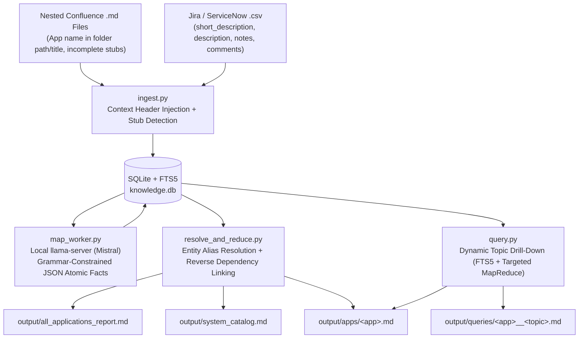

# Application Knowledge MapReduce & Dynamic Drill-Down System

A local-first **MapReduce + Dynamic Topic Drill-Down** pipeline built for:
- **Nested Confluence `.md` files** where the application name often only exists in the folder path or page title, and where many pages or sections are incomplete/stubs.
- **Jira / ServiceNow `.csv` exports** (`short_description`, `description`, `notes`, `comments`).
- **Local `llama-server` (Mistral)** doing 95%+ of the heavy digestion (grammar-constrained JSON Map phase & category-level Reduce).
- **Sparing Large API Model support** with a strict per-run call cap (`max_calls_per_run`) for Entity Resolution, final Dossier synthesis, or on-demand Topic Deep-Dives.

---

## Generated Markdown (`.md`) Outputs

Every run automatically produces structured `.md` files in `output/`:

1. **`output/all_applications_report.md`** — Single consolidated master `.md` report containing the system-wide Mermaid dependency graph and all application dossiers in one file.
2. **`output/system_catalog.md`** — Global architecture index & Mermaid dependency diagram linking to each application's `.md` file.
3. **`output/apps/<application-name>.md`** — Per-application dossier containing:
   - How the application functions
   - Architecture & technical stack
   - Upstream & downstream dependencies (Mermaid flowchart + citation table)
   - Operational failure modes (from tickets) & incomplete Confluence documentation gaps
   - Dynamic Topic Deep-Dives appended on demand
   - Provenance & source index (`[chunk_uid]` $\rightarrow$ file path / ticket ID)
4. **`output/queries/<app>__<topic>.md`** — Standalone `.md` report generated every time you run `python3 cli.py query --topic "..."`.

---

## Architecture & Data Flow



---

## Quick Start

### 1. Run End-to-End with Local `llama-server` (Mistral)
Make sure your `llama-server` is running (default `http://localhost:8080/v1` in `config.yaml`), then run:

```bash
python3 cli.py run-all /path/to/confluence_md_folder /path/to/tickets.csv
```

Or run step-by-step (fully resumable if interrupted):
```bash
python3 cli.py ingest /path/to/confluence_md_folder /path/to/tickets.csv
python3 cli.py map
python3 cli.py reduce
```

### 2. Dynamically Get More Information on Any Topic (Outputs `.md`)
When you need deeper details on a specific topic (for one application or across all applications):

```bash
# Scoped to a specific application (writes output/queries/<app>__<topic>.md AND appends to output/apps/<app>.md)
python3 cli.py query --app "checkout-service" --topic "HikariCP connection pool and Kafka producer latency"

# Across all applications (writes output/queries/all-apps__<topic>.md)
python3 cli.py query --topic "dead letter queues and retry backoff"
```

### 3. Sparingly Use the Larger API Model
To use your limited Large Model API for the final synthesis (while still using local Mistral for the high-volume Map phase):

1. Set your API endpoint/model in `config.yaml` under `large_llm` and export your key:
   ```bash
   export LARGE_LLM_API_KEY="your-api-key"
   ```
2. Pass `--use-large-model` on `reduce` or `query`:
   ```bash
   python3 cli.py --use-large-model reduce --app checkout-service
   python3 cli.py --use-large-model query --app checkout-service --topic "database failover"
   ```
   *(Protected by `max_calls_per_run` in `config.yaml`; automatically falls back to local Mistral if the cap is reached).*

### 4. Check Pipeline & API Budget Status
```bash
python3 cli.py status
```
