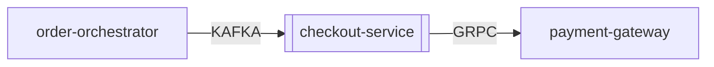

# Global Application Architecture & Dependency Catalog

## System-Wide Dependency Graph

## Discovered Applications

| Application | Dossier File | Last Synthesized By | Updated At |
| :--- | :--- | :--- | :--- |
| **`checkout-service`** | [apps/checkout-service.md](apps/checkout-service.md) | `local:mock-model` | 2026-10-19 04:45:41 |
| **`fraud-engine`** | [apps/fraud-engine.md](apps/fraud-engine.md) | `local:mock-model` | 2026-10-19 04:45:41 |
| **`inventory-service`** | [apps/inventory-service.md](apps/inventory-service.md) | `local:mock-model` | 2026-10-19 04:45:41 |
| **`order-orchestrator`** | [apps/order-orchestrator.md](apps/order-orchestrator.md) | `local:mock-model` | 2026-10-19 04:45:41 |
| **`payment-gateway`** | [apps/payment-gateway.md](apps/payment-gateway.md) | `local:mock-model` | 2026-10-19 04:45:41 |

---

# Application Dossier: `checkout-service`

> **Synthesized by**: `local:mock-model` | **Supporting Chunks**: `5` | **Extracted Facts**: `12`

## 1. How the Application Functions

- [FUNCTION] Ticket ID: INC001089 `[csv:tickets/servicenow_incidents.csv#INC001089]`
- [FUNCTION] Tagged Application/CI: CHKOUT `[csv:tickets/servicenow_incidents.csv#INC001089]`
- [FUNCTION] Short Description: High latency on checkout completion when Inventory Service lags `[csv:tickets/servicenow_incidents.csv#INC001089]`

## 2. Architecture & Technical Stack

- [ARCHITECTURE] [via `POSTGRES`] The service stores active shopping carts and session state in Redis cluster on port 6379 (`redis-carts.internal`) and persists finalized checkout records into PostgreSQL 15 database `checkout_prod_db` on port 5432. `[md:confluence/commerce/checkout-service/architecture/storage-and-calls.md#s1]`
- [ARCHITECTURE] [via `KAFKA`] It also publishes order reservation events to Kafka topic `inventory.reservations.v1` consumed by `inventory-service`. `[md:confluence/commerce/checkout-service/architecture/storage-and-calls.md#s2]`
- [ARCHITECTURE] [via `KAFKA`] Description: Checkout Service threads blocked waiting on Kafka acks. `[csv:tickets/servicenow_incidents.csv#INC001089]`
- [ARCHITECTURE] [via `KAFKA`] Comments: Switched Kafka producer to async batching with linger.ms=10. `[csv:tickets/servicenow_incidents.csv#INC001089]`

## 3. Upstream & Downstream Dependencies

| Direction | Related Application | Protocol / Mechanism | Evidence & Details | Source Citation |
| :--- | :--- | :--- | :--- | :--- |
| **Upstream (Caller)** | `order-orchestrator` | `KAFKA` | Technical / Work Notes: Checkout Service receives upstream cart submit requests from Order Orchestrator over REST API. When publishing to Kafka topic inventory.reservations.v1 with acks=all, broker latency caused HikariCP pool exhaustion on checkout_prod_db. | `csv:tickets/servicenow_incidents.csv#INC001089` |
| **Downstream (Target)** | `payment-gateway` | `GRPC` | During finalization, the service calls `payment-gateway` via synchronous gRPC on port 9090 to authorize the customer's card. | `md:confluence/commerce/checkout-service/architecture/storage-and-calls.md#s2` |

### Dependency Notes
- [UPSTREAM] (Related App: `order-orchestrator`) [via `KAFKA`] Technical / Work Notes: Checkout Service receives upstream cart submit requests from Order Orchestrator over REST API. When publishing to Kafka topic inventory.reservations.v1 with acks=all, broker latency caused HikariCP pool exhaustion on checkout_prod_db. `[csv:tickets/servicenow_incidents.csv#INC001089]`
- [DOWNSTREAM] (Related App: `payment-gateway`) [via `GRPC`] During finalization, the service calls `payment-gateway` via synchronous gRPC on port 9090 to authorize the customer's card. `[md:confluence/commerce/checkout-service/architecture/storage-and-calls.md#s2]`

## 4. Operational Failure Modes & Incomplete Documentation Gaps

- [FAILURE_MODE] Connection pooling uses HikariCP with `maximumPoolSize=40` and `connectionTimeout=3000ms`. `[md:confluence/commerce/checkout-service/architecture/storage-and-calls.md#s1]`
- [INCOMPLETE_GAP] Incomplete section 'Database & Caching Configuration > Failover & Read Replicas' in page 'Database & Caching Configuration' (confluence/commerce/checkout-service/architecture/storage-and-calls.md): 'TODO: Fill in failover promotion procedure after Q3 DR drill.' `[md:confluence/commerce/checkout-service/architecture/storage-and-calls.md#s3]`
- [INCOMPLETE_GAP] Incomplete/stub Confluence page 'Disaster Recovery Runbook' at 'confluence/commerce/checkout-service/runbooks/disaster-recovery.md' (only 4 content words: 'TBD - page under construction.') `[md:confluence/commerce/checkout-service/runbooks/disaster-recovery.md#stub]`
---

## 5. Dynamic Topic Deep-Dives

### Topic: HikariCP connection pool and Kafka producer latency *(Generated 2026-10-19 04:29:40)*

- [Finding] Ticket ID: INC001089 `[csv:tickets/servicenow_incidents.csv#INC001089]`
- [Finding] Tagged Application/CI: CHKOUT `[csv:tickets/servicenow_incidents.csv#INC001089]`
- [Finding] Short Description: High latency on checkout completion when Inventory Service lags `[csv:tickets/servicenow_incidents.csv#INC001089]`
- [Finding] Description: Checkout Service threads blocked waiting on Kafka acks. `[csv:tickets/servicenow_incidents.csv#INC001089]`
- [Finding] Technical / Work Notes: Checkout Service receives upstream cart submit requests from Order Orchestrator over REST API. When publishing to Kafka topic inventory.reservations.v1 with acks=all, broker latency caused HikariCP pool exhaustion on checkout_prod_db. `[csv:tickets/servicenow_incidents.csv#INC001089]`
- [Finding] Comments: Switched Kafka producer to async batching with linger.ms=10. `[csv:tickets/servicenow_incidents.csv#INC001089]`
- [Finding] The service stores active shopping carts and session state in Redis cluster on port 6379 (`redis-carts.internal`) and persists finalized checkout records into PostgreSQL 15 database `checkout_prod_db` on port 5432. `[md:confluence/commerce/checkout-service/architecture/storage-and-calls.md#s1]`
- [Finding] Connection pooling uses HikariCP with `maximumPoolSize=40` and `connectionTimeout=3000ms`. `[md:confluence/commerce/checkout-service/architecture/storage-and-calls.md#s1]`
- [Finding] During finalization, the service calls `payment-gateway` via synchronous gRPC on port 9090 to authorize the customer's card. `[md:confluence/commerce/checkout-service/architecture/storage-and-calls.md#s2]`
- [Finding] It also publishes order reservation events to Kafka topic `inventory.reservations.v1` consumed by `inventory-service`. `[md:confluence/commerce/checkout-service/architecture/storage-and-calls.md#s2]`

---

## Provenance & Source Index

- `csv:tickets/servicenow_incidents.csv#INC001089` — `tickets/servicenow_incidents.csv` (Ticket INC001089)
- `md:confluence/commerce/checkout-service/architecture/storage-and-calls.md#s1` — `confluence/commerce/checkout-service/architecture/storage-and-calls.md` (Database & Caching Configuration > Primary Database)
- `md:confluence/commerce/checkout-service/architecture/storage-and-calls.md#s2` — `confluence/commerce/checkout-service/architecture/storage-and-calls.md` (Database & Caching Configuration > Downstream Calls)
- `md:confluence/commerce/checkout-service/architecture/storage-and-calls.md#s3` — `confluence/commerce/checkout-service/architecture/storage-and-calls.md` (Database & Caching Configuration > Failover & Read Replicas)
- `md:confluence/commerce/checkout-service/runbooks/disaster-recovery.md#stub` — `confluence/commerce/checkout-service/runbooks/disaster-recovery.md` ((Entire Page Stub))

---

# Application Dossier: `fraud-engine`

> **Synthesized by**: `local:mock-model` | **Supporting Chunks**: `1` | **Extracted Facts**: `1`

## 1. How the Application Functions

*No functional overview documented yet in Confluence or tickets (pages may be incomplete stubs).*

## 2. Architecture & Technical Stack

*No internal architecture details extracted yet.*

## 3. Upstream & Downstream Dependencies

| Direction | Related Application | Protocol / Mechanism | Evidence & Details | Source Citation |
| :--- | :--- | :--- | :--- | :--- |
| **Upstream (Caller)** | `payment-gateway` | `REST` | [Inferred from payment-gateway docs/tickets] payment-gateway sends/calls fraud-engine: Technical / Work Notes: Checked pod logs in payments-prod. PAY-GW calls Fraud Engine via REST POST /v2/score before authorizing cards. Fraud Engine returned HTTP 503 due to Redis connection exhaustion. | `csv:tickets/servicenow_incidents.csv#INC001042` |

### Dependency Notes
- [UPSTREAM] (Related App: `payment-gateway`) [via `REST`] [Inferred from payment-gateway docs/tickets] payment-gateway sends/calls fraud-engine: Technical / Work Notes: Checked pod logs in payments-prod. PAY-GW calls Fraud Engine via REST POST /v2/score before authorizing cards. Fraud Engine returned HTTP 503 due to Redis connection exhaustion. `[csv:tickets/servicenow_incidents.csv#INC001042]`

## 4. Operational Failure Modes & Incomplete Documentation Gaps

*No operational failure modes or incomplete documentation stubs recorded.*

---

## Provenance & Source Index

- `csv:tickets/servicenow_incidents.csv#INC001042` — `tickets/servicenow_incidents.csv` (Ticket INC001042)

---

# Application Dossier: `inventory-service`

> **Synthesized by**: `local:mock-model` | **Supporting Chunks**: `1` | **Extracted Facts**: `6`

## 1. How the Application Functions

- [FUNCTION] Ticket ID: INC001115 `[csv:tickets/servicenow_incidents.csv#INC001115]`
- [FUNCTION] Tagged Application/CI: INV-SVC `[csv:tickets/servicenow_incidents.csv#INC001115]`
- [FUNCTION] Description: Inventory counts drifted for high-demand SKUs. `[csv:tickets/servicenow_incidents.csv#INC001115]`

## 2. Architecture & Technical Stack

- [ARCHITECTURE] [via `KAFKA`] Short Description: Duplicate stock deduction on retried Kafka events `[csv:tickets/servicenow_incidents.csv#INC001115]`
- [ARCHITECTURE] [via `KAFKA`] Technical / Work Notes: Inventory Service consumes reservation events from Checkout Service via Kafka topic inventory.reservations.v1 and stores stock levels in Oracle 19c database inv_stock_db. `[csv:tickets/servicenow_incidents.csv#INC001115]`
- [ARCHITECTURE] Comments: Added idempotency key check on order_id in Oracle table STOCK_RESERVATIONS. `[csv:tickets/servicenow_incidents.csv#INC001115]`

## 3. Upstream & Downstream Dependencies

*No upstream or downstream application links discovered yet.*

### Dependency Notes
*No upstream or downstream dependencies found.*

## 4. Operational Failure Modes & Incomplete Documentation Gaps

*No operational failure modes or incomplete documentation stubs recorded.*

---

## Provenance & Source Index

- `csv:tickets/servicenow_incidents.csv#INC001115` — `tickets/servicenow_incidents.csv` (Ticket INC001115)

---

# Application Dossier: `order-orchestrator`

> **Synthesized by**: `local:mock-model` | **Supporting Chunks**: `1` | **Extracted Facts**: `1`

## 1. How the Application Functions

*No functional overview documented yet in Confluence or tickets (pages may be incomplete stubs).*

## 2. Architecture & Technical Stack

*No internal architecture details extracted yet.*

## 3. Upstream & Downstream Dependencies

| Direction | Related Application | Protocol / Mechanism | Evidence & Details | Source Citation |
| :--- | :--- | :--- | :--- | :--- |
| **Downstream (Target)** | `checkout-service` | `KAFKA` | [Inferred from checkout-service docs/tickets] checkout-service consumes/depends on order-orchestrator: Technical / Work Notes: Checkout Service receives upstream cart submit requests from Order Orchestrator over REST API. When publishing to Kafka topic inventory.reservations.v1 with acks=all, broker latency caused HikariCP pool exhaustion on checkout_prod_db. | `csv:tickets/servicenow_incidents.csv#INC001089` |

### Dependency Notes
- [DOWNSTREAM] (Related App: `checkout-service`) [via `KAFKA`] [Inferred from checkout-service docs/tickets] checkout-service consumes/depends on order-orchestrator: Technical / Work Notes: Checkout Service receives upstream cart submit requests from Order Orchestrator over REST API. When publishing to Kafka topic inventory.reservations.v1 with acks=all, broker latency caused HikariCP pool exhaustion on checkout_prod_db. `[csv:tickets/servicenow_incidents.csv#INC001089]`

## 4. Operational Failure Modes & Incomplete Documentation Gaps

*No operational failure modes or incomplete documentation stubs recorded.*

---

## Provenance & Source Index

- `csv:tickets/servicenow_incidents.csv#INC001089` — `tickets/servicenow_incidents.csv` (Ticket INC001089)

---

# Application Dossier: `payment-gateway`

> **Synthesized by**: `local:mock-model` | **Supporting Chunks**: `4` | **Extracted Facts**: `10`

## 1. How the Application Functions

- [FUNCTION] Processes credit card authorizations, captures, and asynchronous settlement webhooks from external banking networks. `[md:confluence/payments/payment-gateway/webhook-processing.md#s1]`
- [FUNCTION] Ticket ID: INC001042 `[csv:tickets/servicenow_incidents.csv#INC001042]`
- [FUNCTION] Tagged Application/CI: PAY-GW `[csv:tickets/servicenow_incidents.csv#INC001042]`
- [FUNCTION] Description: Customers unable to complete card payments during peak flash sale. `[csv:tickets/servicenow_incidents.csv#INC001042]`

## 2. Architecture & Technical Stack

- [ARCHITECTURE] Deployed on AWS EKS in namespace `payments-prod` using Go 1.22 worker pods. `[md:confluence/payments/payment-gateway/webhook-processing.md#s1]`
- [ARCHITECTURE] [via `KAFKA`] Failed settlement messages are pushed to Kafka topic `dlq-payments-settlement` with a 5-retry exponential backoff (initial delay 2s, max delay 60s). `[md:confluence/payments/payment-gateway/webhook-processing.md#s2]`
- [ARCHITECTURE] [via `REST`] Comments: Increased REST timeout between payment-gateway and fraud-engine to 1500ms and enabled circuit breaker fallback. `[csv:tickets/servicenow_incidents.csv#INC001042]`

## 3. Upstream & Downstream Dependencies

| Direction | Related Application | Protocol / Mechanism | Evidence & Details | Source Citation |
| :--- | :--- | :--- | :--- | :--- |
| **Upstream (Caller)** | `checkout-service` | `GRPC` | [Inferred from checkout-service docs/tickets] checkout-service sends/calls payment-gateway: During finalization, the service calls `payment-gateway` via synchronous gRPC on port 9090 to authorize the customer's card. | `md:confluence/commerce/checkout-service/architecture/storage-and-calls.md#s2` |
| **Downstream (Target)** | `fraud-engine` | `REST` | Technical / Work Notes: Checked pod logs in payments-prod. PAY-GW calls Fraud Engine via REST POST /v2/score before authorizing cards. Fraud Engine returned HTTP 503 due to Redis connection exhaustion. | `csv:tickets/servicenow_incidents.csv#INC001042` |

### Dependency Notes
- [UPSTREAM] (Related App: `checkout-service`) [via `GRPC`] [Inferred from checkout-service docs/tickets] checkout-service sends/calls payment-gateway: During finalization, the service calls `payment-gateway` via synchronous gRPC on port 9090 to authorize the customer's card. `[md:confluence/commerce/checkout-service/architecture/storage-and-calls.md#s2]`
- [DOWNSTREAM] (Related App: `fraud-engine`) [via `REST`] Technical / Work Notes: Checked pod logs in payments-prod. PAY-GW calls Fraud Engine via REST POST /v2/score before authorizing cards. Fraud Engine returned HTTP 503 due to Redis connection exhaustion. `[csv:tickets/servicenow_incidents.csv#INC001042]`

## 4. Operational Failure Modes & Incomplete Documentation Gaps

- [FAILURE_MODE] Short Description: 503 Gateway Timeout during card authorization `[csv:tickets/servicenow_incidents.csv#INC001042]`

---

## Provenance & Source Index

- `csv:tickets/servicenow_incidents.csv#INC001042` — `tickets/servicenow_incidents.csv` (Ticket INC001042)
- `md:confluence/commerce/checkout-service/architecture/storage-and-calls.md#s2` — `confluence/commerce/checkout-service/architecture/storage-and-calls.md` (Database & Caching Configuration > Downstream Calls)
- `md:confluence/payments/payment-gateway/webhook-processing.md#s1` — `confluence/payments/payment-gateway/webhook-processing.md` (Webhook & Settlement Processing > Functional Overview)
- `md:confluence/payments/payment-gateway/webhook-processing.md#s2` — `confluence/payments/payment-gateway/webhook-processing.md` (Webhook & Settlement Processing > Dead Letter Queue & Retry Policy)

---

