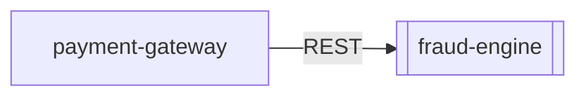

# Application Dossier: `fraud-engine`

> **Synthesized by**: `local:mock-model` | **Supporting Chunks**: `1` | **Extracted Facts**: `1`

## 1. How the Application Functions

*No functional overview documented yet in Confluence or tickets (pages may be incomplete stubs).*

## 2. Architecture & Technical Stack

*No internal architecture details extracted yet.*

## 3. Upstream & Downstream Dependencies

| Direction | Related Application | Protocol / Mechanism | Evidence & Details | Source Citation |
| :--- | :--- | :--- | :--- | :--- |
| **Upstream (Caller)** | `payment-gateway` | `REST` | [Inferred from payment-gateway docs/tickets] payment-gateway sends/calls fraud-engine: Technical / Work Notes: Checked pod logs in payments-prod. PAY-GW calls Fraud Engine via REST POST /v2/score before authorizing cards. Fraud Engine returned HTTP 503 due to Redis connection exhaustion. | `csv:tickets/servicenow_incidents.csv#INC001042` |

### Dependency Notes
- [UPSTREAM] (Related App: `payment-gateway`) [via `REST`] [Inferred from payment-gateway docs/tickets] payment-gateway sends/calls fraud-engine: Technical / Work Notes: Checked pod logs in payments-prod. PAY-GW calls Fraud Engine via REST POST /v2/score before authorizing cards. Fraud Engine returned HTTP 503 due to Redis connection exhaustion. `[csv:tickets/servicenow_incidents.csv#INC001042]`

## 4. Operational Failure Modes & Incomplete Documentation Gaps

*No operational failure modes or incomplete documentation stubs recorded.*

---

## Provenance & Source Index

- `csv:tickets/servicenow_incidents.csv#INC001042` — `tickets/servicenow_incidents.csv` (Ticket INC001042)
