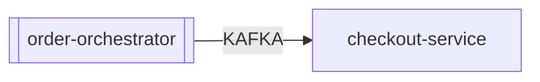

# Application Dossier: `order-orchestrator`

> **Synthesized by**: `local:mock-model` | **Supporting Chunks**: `1` | **Extracted Facts**: `1`

## 1. How the Application Functions

*No functional overview documented yet in Confluence or tickets (pages may be incomplete stubs).*

## 2. Architecture & Technical Stack

*No internal architecture details extracted yet.*

## 3. Upstream & Downstream Dependencies

| Direction | Related Application | Protocol / Mechanism | Evidence & Details | Source Citation |
| :--- | :--- | :--- | :--- | :--- |
| **Downstream (Target)** | `checkout-service` | `KAFKA` | [Inferred from checkout-service docs/tickets] checkout-service consumes/depends on order-orchestrator: Technical / Work Notes: Checkout Service receives upstream cart submit requests from Order Orchestrator over REST API. When publishing to Kafka topic inventory.reservations.v1 with acks=all, broker latency caused HikariCP pool exhaustion on checkout_prod_db. | `csv:tickets/servicenow_incidents.csv#INC001089` |

### Dependency Notes
- [DOWNSTREAM] (Related App: `checkout-service`) [via `KAFKA`] [Inferred from checkout-service docs/tickets] checkout-service consumes/depends on order-orchestrator: Technical / Work Notes: Checkout Service receives upstream cart submit requests from Order Orchestrator over REST API. When publishing to Kafka topic inventory.reservations.v1 with acks=all, broker latency caused HikariCP pool exhaustion on checkout_prod_db. `[csv:tickets/servicenow_incidents.csv#INC001089]`

## 4. Operational Failure Modes & Incomplete Documentation Gaps

*No operational failure modes or incomplete documentation stubs recorded.*

---

## Provenance & Source Index

- `csv:tickets/servicenow_incidents.csv#INC001089` — `tickets/servicenow_incidents.csv` (Ticket INC001089)
