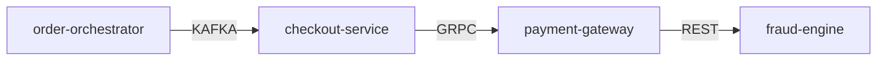

# Global Application Architecture & Dependency Catalog

## System-Wide Dependency Graph

## Discovered Applications

| Application | Dossier File | Last Synthesized By | Updated At |
| :--- | :--- | :--- | :--- |
| **`checkout-service`** | [apps/checkout-service.md](apps/checkout-service.md) | `local:mock-model` | 2026-10-19 04:45:41 |
| **`fraud-engine`** | [apps/fraud-engine.md](apps/fraud-engine.md) | `local:mock-model` | 2026-10-19 04:45:41 |
| **`inventory-service`** | [apps/inventory-service.md](apps/inventory-service.md) | `local:mock-model` | 2026-10-19 04:45:41 |
| **`order-orchestrator`** | [apps/order-orchestrator.md](apps/order-orchestrator.md) | `local:mock-model` | 2026-10-19 04:45:41 |
| **`payment-gateway`** | [apps/payment-gateway.md](apps/payment-gateway.md) | `local:mock-model` | 2026-10-19 04:45:41 |
